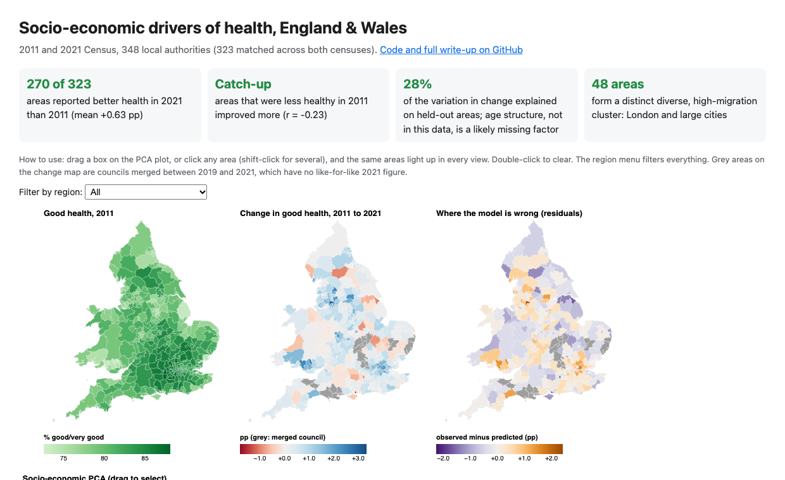
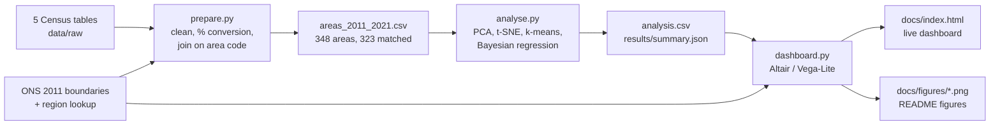
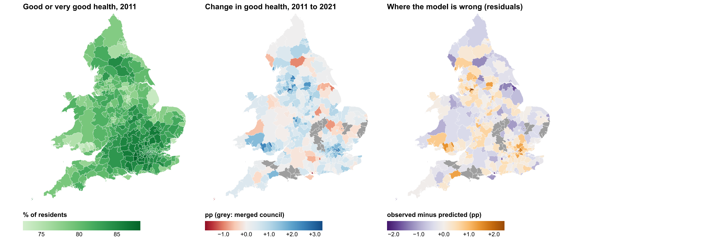
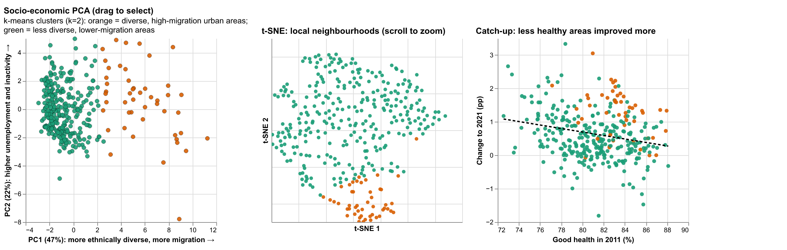
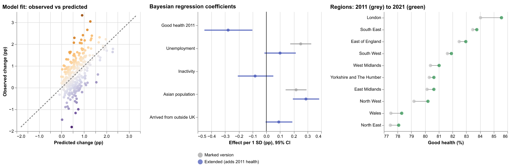

<div align="center">

# Socio-Economic Drivers of Health, England & Wales

**Which areas got healthier between the 2011 and 2021 Census, and which socio-economic factors explain the difference?**

[](https://ishaan-bhalla.github.io/Visual_Analytics/)
[](#9-reproduce-it)
[](#3-data)

<a href="https://ishaan-bhalla.github.io/Visual_Analytics/"></a>

</div>

## Key findings

- **270 of 323** local authorities reported better general health in 2021 than in 2011, but the average gain was small: **+0.63 percentage points** of residents in good or very good health (range −1.81 to +3.33).
- **Catch-up:** areas that were less healthy in 2011 improved more (r = −0.23). Once the model accounts for this, the apparent link between unemployment and health change shrinks and is no longer clearly different from zero.
- **London and large diverse cities improved most.** A data-driven cluster of **48** ethnically diverse, high-migration areas gained **+1.27 pp** on average, against **+0.52 pp** for the other 300. London's 33 boroughs rose from 84.0% to 85.6%.
- **The model explains about 28% of the variation** in change on held-out areas, and its 95% intervals contain 94% of real outcomes. Most of the variation comes from factors this data does not include, most likely age structure.

These are area-level associations, not causes (see [Limitations](#8-limitations-and-ethics)).

## Contents

1. [Problem and users](#1-problem-and-users)
2. [What changed after marking](#2-what-changed-after-marking)
3. [Data](#3-data)
4. [Pipeline](#4-pipeline)
5. [Methods](#5-methods)
6. [The dashboard](#6-the-dashboard)
7. [Results](#7-results)
8. [Limitations and ethics](#8-limitations-and-ethics)
9. [Reproduce it](#9-reproduce-it)
10. [Repository structure](#10-repository-structure)
11. [References and licence](#11-references-and-licence)

## 1. Problem and users

Health in England and Wales is unequal between places, and the Census is the only source that measures self-reported health, employment, ethnicity and migration for every local authority at the same moment. With two Censuses ten years apart, we can ask:

| # | Research question | Answered by |
|---|---|---|
| RQ1 | How is health distributed across local authorities, and how did it change from 2011 to 2021? | Maps 1 and 2, regional dumbbell chart |
| RQ2 | Which areas are socio-economically alike, and do those groups share health outcomes? | PCA, t-SNE and k-means clusters, linked to the maps |
| RQ3 | Which 2011 characteristics are associated with health change, and how certain are we? | Bayesian regression, coefficient chart, residual map |

**Intended users**

- **Public-health analysts and local-authority policy teams:** find areas that are falling behind, and areas doing better or worse than their socio-economic profile predicts (the residual map), as candidates for closer study.
- **Researchers:** a reproducible, documented starting point for area-level analysis of the two Censuses.

The design follows Munzner's task taxonomy (explore, compare, identify, summarise, predict); [section 6](#6-the-dashboard) maps each task to a view.

## 2. What changed after marking

This started as my individual coursework for **Visual Analytics (EMATM0066), MSc Data Science, University of Bristol**, submitted in May 2026 with a Tableau dashboard. After it was marked I rebuilt it to address every point in the feedback. The analysis code, maps, linked views and this write-up are all **post-marking work**.

| Marker's feedback | What changed |
|---|---|
| Motivation and research focus are general | Three research questions and named users ([section 1](#1-problem-and-users)) |
| Data preparation lacks exact census tables, final sample size, boundary matching and missing-value handling | Every table named; area counts logged at each step; six recoded councils and 25 merged councils documented; missing values checked and reported ([section 3](#3-data)) |
| Chart types are limited; no maps | Three choropleth maps, a regional dumbbell chart, a coefficient plot with credible intervals and an observed-vs-predicted plot, alongside the scatter plots |
| Little interaction between views | The seven area-level views share one selection: brush the PCA or click any area, and it is highlighted in all of them; one region filter drives every view; a menu recolours the first map by any variable, and the scatters zoom and pan |
| Conclusion is basic | Quantified findings, a corrected direction for unemployment (see below), and an extended model that controls for 2011 health |
| Report short; figures not annotated | This README, with a takeaway under every figure |

**A correction.** The marked report said that higher unemployment was associated with *smaller* health improvements. Its own model said the opposite: the unemployment coefficient was **+0.13** per percentage point (95% credible interval +0.09 to +0.17). Areas with higher unemployment improved *more*. The extended model below shows most of that is catch-up from a lower 2011 starting point.

## 3. Data

All tables are from the ONS Census, downloaded from [Nomis](https://www.nomisweb.co.uk/), at local authority district level. Health is self-reported general health; "good health" means the share of residents reporting *good* or *very good* health.

| File (`data/raw/`) | Census table | Coverage | Areas | Variables used |
|---|---|---|---|---|
| `employment.csv` | 2011 KS601UK, economic activity | UK | 406 | Employment, unemployment, inactivity, full-time and part-time shares |
| `migration.csv` | 2011 migration by ethnic group | UK | 406 | Same address a year ago; moved within the area, from elsewhere in the UK, from outside the UK; moved out |
| `ethnic_groups.csv` | 2011 KS201EW, ethnic group | England & Wales | 348 | White, Mixed, Asian, Black, Other shares |
| `health.csv` | 2011 KS301EW, health and unpaid care | England & Wales | 348 | General health (5 levels); day-to-day activities limited |
| `health21.csv` | 2021 TS037, general health | England & Wales | 331 | General health (5 levels) |

Boundaries come from the [ONS Open Geography Portal](https://geoportal.statistics.gov.uk/): *Local Authority Districts (December 2011), generalised clipped boundaries, England & Wales*, simplified for the web, with a December 2011 district-to-region lookup (`data/geo/`).

### From 406 areas to 323

| Step | Areas | Why |
|---|---|---|
| Employment and migration tables | 406 | UK-wide: includes Scotland and Northern Ireland |
| Join with ethnicity and health (on area code) | **348** | England & Wales only; every area has a 2011 boundary and region |
| Match to 2021 health (on area code) | **323** | 25 councils were merged into new ones in 2019-21 and have no like-for-like 2021 figure |

**Boundary matching.**

- **Recoded councils.** The 2011 tables use the codes ONS reissued after small boundary changes in 2013-14. Six councils therefore carry a newer code than the December 2011 boundary file, and are mapped back so every area joins its polygon: Northumberland, Gateshead, St Albans, Welwyn Hatfield, East Hertfordshire and Stevenage (`RECODED_TO_2011` in `src/prepare.py`).
- **Merged councils (excluded from the change analysis, grey on the maps).**
  - **Northamptonshire (7):** Corby, Daventry, East Northamptonshire, Kettering, Northampton, South Northamptonshire, Wellingborough
  - **Suffolk (4):** Forest Heath, St Edmundsbury, Suffolk Coastal, Waveney
  - **Buckinghamshire (4):** Aylesbury Vale, Chiltern, South Bucks, Wycombe
  - **Dorset and BCP (8):** Bournemouth, Poole, Christchurch, East Dorset, North Dorset, Purbeck, West Dorset, Weymouth and Portland
  - **Somerset West and Taunton (2):** Taunton Deane, West Somerset

  Aggregating them into their successor councils would mix 2011 and 2021 geographies, so they stay in the 2011-only views (maps, PCA, clusters).

**Missing values and duplicates.** Every table was checked for missing values and duplicate area codes. There were none (`data/processed/pipeline_log.json`), so no rows were imputed or dropped for missingness. Rows leave the data only through the geographic joins above.

**Derived variables.** Counts are converted to percentages so that areas of different size are comparable. Employment and unemployment are shares of the economically active; inactivity is a share of all residents aged 16-74; all other variables are shares of usual residents. **Health change** is the 2021 minus the 2011 good-health share, in percentage points (pp).

## 4. Pipeline

[](https://gitdiagram.com/ishaan-bhalla/visual_analytics?utm_source=readme&utm_medium=picture)

*Repository architecture (GitDiagram; click to explore it interactively). The flow below shows how data moves through the scripts.*



## 5. Methods

**Dimensionality reduction.** All features are standardised first.

- **PCA as marked:** on all 20 variables, health included. It captures **73.3%** of variance in two components, reproducing the marked version.
- **PCA in the dashboard:** on the **15 socio-economic variables only**, so that colouring by health is not circular. It captures **69.7%** of variance (PC1 47%, PC2 22%).
- **Reading the axes:**
  - **PC1** rises with ethnic diversity and international migration. The largest loadings are Mixed, from outside the UK, Other and Black (positive), and White (negative).
  - **PC2** rises with unemployment and inactivity, and falls with employment.
- **t-SNE** (perplexity 30) gives a non-linear view of local neighbourhoods. Its axes have no meaning; only closeness does.

**Clustering.** k-means on the standardised socio-economic variables, with k = 2 to 8 compared by silhouette score. **k = 2** scored clearly best (0.51; every other k was 0.26 or less). The clusters are:

- **48 diverse, high-migration urban areas:** 29 London boroughs, plus Manchester, Birmingham, Leicester, Bristol, Cardiff, Oxford, Cambridge and similar cities.
- **300 less diverse, lower-migration areas.**

**Bayesian linear regression.** The outcome is health change, 2011 to 2021 (323 areas). The prior is the standard reference prior, p(β, σ²) ∝ 1/σ², giving a closed-form posterior. I take 4,000 posterior draws and report 95% credible intervals, and predictions carry 95% posterior predictive intervals.

| Model | Predictors (2011 values) |
|---|---|
| Intercept only | none (baseline) |
| **Marked version** | unemployment, Asian population share |
| **Extended** | good health, unemployment, inactivity, Asian population share, arrived from outside the UK |

Predictors are standardised, so each coefficient is the change in pp per one standard deviation. I compare models with **5-fold cross-validation**: out-of-sample RMSE, R², and how often the 95% interval contains the observed value.

## 6. The dashboard

**[Open the live dashboard](https://ishaan-bhalla.github.io/Visual_Analytics/)** (one HTML page, nothing to install).

**Linked views.** The maps and scatter plots are drawn from the same per-area table, so a selection in one shows in all of them:

- **Drag a box** on the PCA plot to select a group of areas.
- **Click** any area on a map or scatter; **shift-click** to add more; **double-click** to clear.
- **Filter by region** at the top; every view, maps included, zooms and filters.
- **Choose a variable** for the first map: any of the 20 Census variables (health, employment, ethnicity, migration).
- **Scroll to zoom and drag to pan** on the t-SNE, catch-up and model-fit plots; double-click resets them.
- **Hover** for exact values.

| View | Munzner task | Question |
|---|---|---|
| Map: any 2011 variable (menu; good health by default) | Explore, identify | RQ1, RQ2 |
| Map: change 2011 to 2021 | Compare, identify | RQ1 |
| Map: model residuals | Identify outliers, assess | RQ3 |
| Socio-economic PCA (brushable) | Explore, identify clusters | RQ2 |
| t-SNE | Explore local structure | RQ2 |
| Catch-up scatter | Summarise, compare | RQ1, RQ3 |
| Observed vs predicted | Predict, assess | RQ3 |
| Coefficient plot | Summarise, assess uncertainty | RQ3 |
| Regional dumbbell | Compare | RQ1 |

**Design choices.**

- **Position** is used for the precise quantitative comparisons (scatters, coefficients, dumbbell).
- **Colour** encodes one quantity per map, with diverging scales centred on zero for change and residuals, and a colour-blind-safe pair (orange/green) for the two clusters.
- **Opacity** shows the selection, so unselected areas stay visible as context.
- **Grey** always means "no like-for-like 2021 value".
- **Tooltips** give exact values on demand: overview first, zoom and filter, then details on demand.

## 7. Results

### Where people are healthier, and where health changed



*Left: good health in 2011 is highest in London and the South East, and lowest in South Wales, the North East and former industrial areas. Middle: most areas improved slightly (blue), with the largest gains in London, Greater Manchester and parts of South Wales; grey councils were merged in 2019-21. Right: orange areas did better than the model predicted, purple worse.*

- **Largest gains:** Salford (+3.33 pp), Barking and Dagenham (+3.05), Merthyr Tydfil (+2.66).
- **Largest falls:** Gosport (−1.81), the Isles of Scilly (−1.47), Rushmoor (−1.16).
- **Doing worse than their profile predicts:** Gosport, Rushmoor and North East Lincolnshire have the most negative residuals, which makes them the most interesting candidates for local follow-up.

### Socio-economic structure



*Left: the 48 diverse, high-migration areas (orange) separate clearly along PC1. Middle: t-SNE shows the same split as a compact neighbourhood. Right: areas with lower 2011 health tended to improve more (dashed line: least-squares fit).*

### Model results



*Left: predictions are compressed towards the mean, so the model under-predicts the largest changes. Middle: once 2011 health is included (blue), unemployment's effect shrinks and its interval crosses zero; the Asian population share remains positive. Right: every region improved, London most.*

| Model (5-fold CV) | RMSE (pp) | R² | 95% interval coverage |
|---|---|---|---|
| Intercept only | 0.743 | 0.00 | 93.5% |
| Marked version | 0.634 | 0.27 | 95.0% |
| Extended | **0.630** | **0.28** | 94.4% |

**Extended model coefficients** (pp change per 1 SD, 95% credible interval):

| Predictor | Effect | 95% CI | Reading |
|---|---|---|---|
| Good health 2011 | −0.28 | −0.45 to −0.10 | Catch-up: lower starting health, larger gain |
| Unemployment | +0.10 | −0.01 to +0.21 | Weak once 2011 health is included |
| Inactivity | −0.08 | −0.21 to +0.05 | No clear effect |
| Asian population share | +0.29 | +0.19 to +0.38 | Clear positive association |
| Arrived from outside the UK | +0.09 | −0.01 to +0.19 | Weak, uncertain |

**Conclusion.** Health improved slightly almost everywhere, most in London and diverse cities and least in parts of the South East and South West. Part of the variation is catch-up by areas that started less healthy. Unemployment adds little once that is accounted for. Areas with larger Asian populations improved more, but the likeliest explanation is a confounder this data lacks, such as a younger age structure, not ethnicity itself. The extended model adds little predictive power over the marked one (R² 0.28 vs 0.27), so its value is in interpretation, not forecasting.

## 8. Limitations and ethics

- **Ecological data.** These are associations between areas, not individuals. They say nothing about whether any individual's health depends on their employment or ethnicity.
- **Missing confounders.** Age structure, deprivation and access to healthcare are not in this data and probably drive much of the unexplained variation. The ethnicity association in particular should not be read as causal.
- **Self-reported health and COVID-19.** The 2021 Census took place during the pandemic (21 March 2021), which may have changed how people rated their health.
- **Boundary changes.** 25 merged councils are excluded from the change analysis. They are a mix of towns (Bournemouth, Poole, Northampton) and rural districts, so the change analysis covers 323 of 348 areas, not all of them.
- **Responsible framing.** Ethnicity and migration variables can be misused to stigmatise places or groups. The dashboard presents them only as area-level context, with uncertainty shown, and the write-up warns against causal readings.

## 9. Reproduce it

Needs Python 3.11 or later. Every number and figure in this README is regenerated from the raw data in under a minute.

```bash
git clone https://github.com/ishaan-bhalla/Visual_Analytics.git
cd Visual_Analytics
python -m venv .venv && source .venv/bin/activate
pip install -r requirements.txt

python src/prepare.py     # clean and join -> data/processed/areas_2011_2021.csv
python src/analyse.py     # PCA, t-SNE, clusters, models -> results/summary.json
python src/dashboard.py   # docs/index.html and docs/figures/*.png
```

Open `docs/index.html` in a browser to use the dashboard locally. Random seeds are fixed (42), so results are identical between runs.

## 10. Repository structure

```
Visual_Analytics/
├── data/
│   ├── raw/                 # five Census tables, as downloaded from Nomis
│   ├── geo/                 # ONS Dec 2011 district boundaries + region lookup
│   └── processed/           # generated: cleaned areas, analysis output, pipeline log
├── src/
│   ├── prepare.py           # cleaning, % conversion, joins, boundary matching
│   ├── analyse.py           # PCA, t-SNE, k-means, Bayesian regression, cross-validation
│   └── dashboard.py         # linked Altair dashboard and README figures
├── results/summary.json     # every headline number in this README
├── docs/                    # GitHub Pages site: index.html + figures/
└── requirements.txt
```

## 11. References and licence

**References**

- Munzner, T. (2014). *Visualization Analysis and Design*. CRC Press.
- Shneiderman, B. (1996). The eyes have it: a task by data type taxonomy for information visualizations. *Proceedings of the IEEE Symposium on Visual Languages*, 336-343.
- van der Maaten, L. and Hinton, G. (2008). Visualizing data using t-SNE. *Journal of Machine Learning Research*, 9, 2579-2605.
- Gelman, A. et al. (2013). *Bayesian Data Analysis* (3rd ed.). CRC Press.
- Office for National Statistics. 2011 Census and Census 2021 tables, via Nomis; ONS Open Geography Portal boundaries.

**Licence.** Code: MIT. Data: contains public sector information licensed under the [Open Government Licence v3.0](https://www.nationalarchives.gov.uk/doc/open-government-licence/version/3/); boundaries contain OS data © Crown copyright and database right.

**Author:** Ishaan Bhalla · [LinkedIn](https://www.linkedin.com/in/bhalla-ishaan) · [GitHub](https://github.com/ishaan-bhalla)
